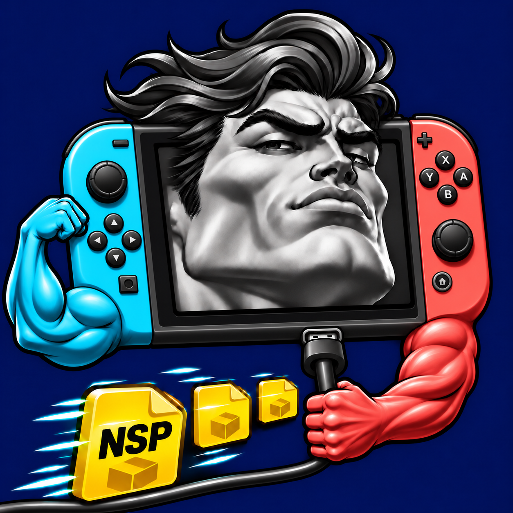

<p align="center">
  
</p>

<h1 align="center">SwoleLoader</h1>

<p align="center">
  <strong>💪 Never skip install day.</strong><br>
  Bulk-install NSP, NSZ, XCI and XCZ games on your Nintendo Switch, straight from a USB drive.
</p>

<p align="center">
  
  
  <a href="https://github.com/ITotalJustice/sphaira"></a>
</p>

> [!NOTE]
> SwoleLoader is a fork of [**Sphaira**](https://github.com/ITotalJustice/sphaira) by ITotalJustice. It keeps Sphaira's file browser, USB drive support and YATI installer, and rebuilds the app around one job: installing a whole library of games as fast as the hardware allows. See [Credits](#credits).

## Features

**Installing**

- 📦 **Batch installs.** Select any number of game folders, or a whole library, and install everything in one run. Base games, updates and DLC are found in subfolders.
- 🗂️ **Formats:** NSP, NSZ, XCI and XCZ, plus MSP mod packages.
- 🔌 **Straight from the drive.** Packages install directly from the USB drive, never copied to the microSD card first.
- 🧾 **Review before installing.** Packages are grouped by game, with source and installed sizes and a free-space check. You can take out single packages or whole games and undo that.
- 📊 **Whole-list progress.** Switch between the current game and the whole batch, with bytes installed, a progress bar and the time left.
- 💾 **Choose where games go:** microSD card or system memory, on sysMMC or emuMMC.

**Built for long batches**

- 🔋 **Battery guard.** On battery, SwoleLoader warns before starting a batch when the charge is low, stops starting new games as it gets lower, and cancels cleanly before the console dies.
- 🌙 **Screen off during installs** to save power, with the install still running.
- ⚡ **Recovery after power loss.** Partly written data from an install that was cut off is removed at the next launch.
- 🚀 **Fast browsing.** Folders with up to 100,000 entries load on a background worker, and sizes are calculated only for what you select.

**Everything else**

- 🧲 **USB drives:** FAT32, exFAT and NTFS. They are write-protected by default.
- 📁 **File manager:** copy, move, rename, delete, zip and unzip, hash, text editor, image viewer and a split view.
- 🏠 **Forwarders.** Give any homebrew app its own icon on the HOME screen.
- 🔄 **Signed updates over the air** from this repository's releases.
- 📝 **Logs, crash reports and batch reports** on the microSD card.
- 🌍 **16 languages.**

## Requirements

- A Nintendo Switch running custom firmware (Atmosphère) with the homebrew menu.
- The homebrew menu started in **full application mode**: on a standard Atmosphère setup, hold **R** while opening any installed game.
- A USB drive connected to the Switch's USB-C port, the dock, or a USB-C hub.

## Installation

1. Download the latest release from the [Releases page](https://github.com/AlanConstantino/SwoleLoader/releases).
2. Extract `swoleloader-<version>.zip` at the root of your microSD card, or copy `swoleloader.nro` to `/switch/swoleloader/`.
3. Open the homebrew menu and launch **SwoleLoader**.

After that, SwoleLoader keeps itself up to date (see [Updates](#updates)).

<details>
<summary>Upgrading from NXLoader-GPT</summary>

Builds from before the rename were called NXLoader-GPT and lived in `/switch/nxloader-gpt/`. Delete that folder once SwoleLoader is installed. SwoleLoader copies your old settings from `/config/nxloader/config.ini` the first time it starts.

</details>

## Quick start

1. Plug in your USB drive. In the file browser, press **X → Mount** and choose the drive.
2. Browse to your games. Select each game folder with **ZL**, **ZR** or **R3**, or use **X → Select all visible**. Selections are kept as you move between folders.
3. Press **X → Scan and install selection**. If installing is turned off on this console, SwoleLoader asks to turn it on.
4. Check the review, take out anything you don't want, and choose **Install selected**.
5. Wait for it to finish. Afterwards you're back in the review: anything that failed is still selected, so you can retry it.

To install a single file, highlight it and press **A**.

To change where games are installed, go to **Y → Advanced Options → Install options → Install location** before you open the review.

A report of the last batch is saved to `/config/swoleloader/last-batch.txt`.

## Controls

| Where | Button | Action |
| --- | --- | --- |
| File browser | **A** | Open a folder, review a package for install, or view an image |
| | **ZL** / **ZR** / **R3** | Select or deselect |
| | **X** | Options: mount, install, file operations, forwarders |
| | **Y** | Menu: settings, updates, language, USB drives |
| | **L3** | Split view |
| | **B** | Back |
| | **+** | Return to the homebrew menu |
| Review | **X** | Remove the highlighted package or game |
| | **Y** | Undo removals |
| | **L** | Retry sizing, or rescan an unreadable folder |
| | **A** | Details |
| Installing | **X** | Switch between the current game and the whole list |
| | **B** | Cancel |

## Forwarders

To give a homebrew app its own HOME screen icon, highlight its `.nro` on the microSD card and press **X → Install Forwarder**. Before it installs, you can change the title and choose the icon from:

- the `.nro` itself;
- an image file;
- SteamGridDB, which needs your own API key.

Installing must be turned on, the same as for games.

## Battery and power loss

In handheld mode the USB drive takes the only USB-C port, so the Switch can't charge during a long batch. For big installs, use the dock with the drive plugged into it, or a USB-C hub with charging passthrough. Flash drives and SSDs use far less power than hard drives.

- **Battery guard** (**Install options → Stop when battery is low**, on by default). On battery, SwoleLoader:
  - asks before starting a batch below 30%;
  - starts no new game at 15% or below;
  - cancels the current game at 5%, removing its partly written data.

  Games already installed are kept, and the rest stay in the review. On the dock or a full-power charger the guard does nothing.
- **Screen off during installs** (**Advanced Options**, after 1 minute by default). Any button or touch turns the screen back on, and **Y** turns it off at once.
- **Boost only for compressed games** (**Advanced Options**, on by default). The CPU is boosted only while NSZ and XCZ content is unpacked. Plain NSP and XCI installs are limited by the drive, not the CPU.

If an install is cut off by power loss or a crash, its partly written data is cleaned up the next time SwoleLoader starts, and a notification says how much space came back. Install the same selection again: with **Skip if already installed** on, the games that finished are skipped quickly.

## Updates

SwoleLoader checks this repository's releases at launch and from **Y → Check for updates**. It always asks before installing an update. It only installs releases signed with the project's key, so a tampered download or another app's release is rejected. Turn off the launch check under **Advanced Options → Check for updates on launch**.

## Logs and crash reports

Logs are on by default (**Y → Advanced Options → Logging**) and go to `/config/swoleloader/logs/`:

| File | Contents |
| --- | --- |
| `log.txt` | This session |
| `previous.txt` | The session before. Read this one after a crash or freeze |
| `crash.txt` | The most recent crash, written even with logging off |

Read them on the console with **Y → Advanced Options → View logs**. To turn a crash report's addresses into functions and source lines, use the symbols file from the same release:

```sh
tools/symbolize.sh swoleloader-0.1.6.elf crash.txt
```

## Building from source

You need Podman or Docker. The build script makes a pinned devkitA64/libnx image and keeps a compile cache between runs.

```sh
./tools/nxloader-build.sh Release      # or Dev
sh tests/nxloader/run.sh               # host tests
```

The app ends up in `build/Release/swoleloader.nro`.

- `./build_release.sh` builds a signed release into `dist/`.
- The app's name, version, folder and update repository are set in [`app.cmake`](app.cmake).
- [RELEASING.md](RELEASING.md) covers publishing a version and the signing key.
- [docs/TECHNICAL.md](docs/TECHNICAL.md) explains the browser and installer internals and what the host tests cover.

## Credits

SwoleLoader is built on [**Sphaira**](https://github.com/ITotalJustice/sphaira) by [ITotalJustice](https://github.com/ITotalJustice) and its contributors. It is based on [NaGaa95/sphaira](https://github.com/NaGaa95/sphaira) at commit `8430e420f0ea4ea800c6689f6797c38e97aafbc0` (Sphaira 1.0.9). The installer, file browser, USB drive support and much of the UI come from Sphaira. Sphaira's original README and full credits are kept in [UPSTREAM.md](UPSTREAM.md).

SwoleLoader keeps its settings and caches in `/config/swoleloader/`, so it can sit next to Sphaira on the same microSD card without the two touching each other's settings.

Thanks also to the libraries SwoleLoader depends on, including [libnx](https://github.com/switchbrew/libnx), [libusbhsfs](https://github.com/DarkMatterCore/libusbhsfs), [nx-hbloader](https://github.com/switchbrew/nx-hbloader), [deko3d-nanovg](https://github.com/Adubbz/nanovg-deko3d), [libpulsar](https://github.com/p-sam/switch-libpulsar) and [zstd](https://github.com/facebook/zstd).

## License

SwoleLoader is licensed under the [GNU General Public License v3.0](LICENSE), the same license as Sphaira.
